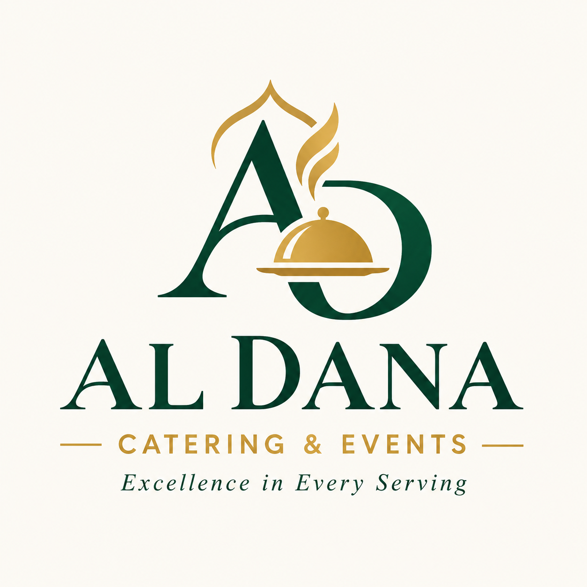
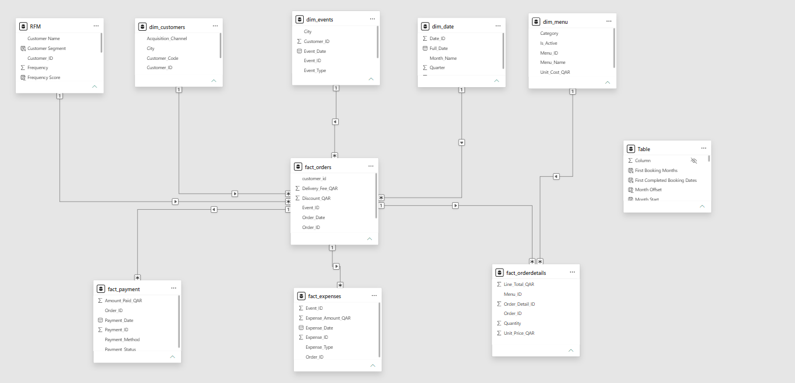
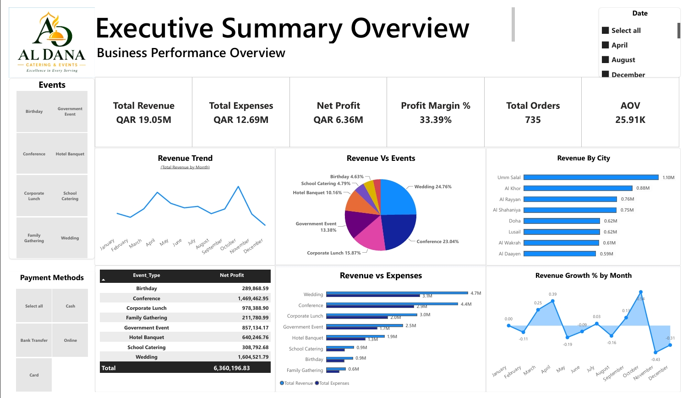
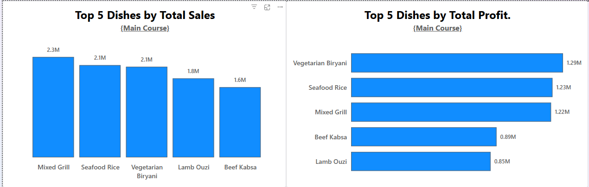

<table>
<tr>
<td width="180" align="center">

</td>

<td width="700" align="left">

<h1>Food Services Operations Analytics </h1>

<h3>Al Dana Catering Company</h3>

Catering &amp; Event Management Analytics | Qatar | 2025–2026

</td>
</tr>
</table>

---
### Client Background

**Al Dana Catering** is a catering and event management company operating in Qatar. The company provides catering for corporate meetings, weddings, private functions, conferences, and large-scale institutional events.

Al Dana Catering's dataset comprises **300 customers, 500 events, and 960 orders**, with more than **3,300 order** detail records across **28 menu items**. The available business data covers multiple dimensions and metrics, including sales revenue, customer segments, event types, menu performance, operating expenses, geographic distribution, order fulfilment, and payment methods.

Reporting to the Head of Operations, an analysis was conducted to evaluate Al Dana Catering's 2025–2026 performance, providing insights to improve profitability, control costs, enhance operational efficiency, and strengthen customer retention.

## **The key insights and recommendations focus on the following areas:**

- **The Catering Manager:**  wants to understand **why Main Course generates higher sales** than other menu categories and identify strategies to improve the sales and profitability of Starters, Desserts, and Beverages.
- **Human and Resources Department:** How effectively does Al Dana Catering Company manage its cash inflows and outflows, and how do payment methods, outstanding balances, and payment delays affect its cash flow?
- **Operation Manager:** Which event types generate the highest demand, and how does demand change over time to help the company optimize catering resources and increase revenue?

## <u>Dataset Structure and ERD (Entity Relationship Diagram)</u>

The Al Dana Catering Company data model consists of 10 tables, organized into dimension tables, fact tables, and analytical support tables. The central `fact_orders` table stores order-level transactions and connects to customer, event, and date dimensions. The `fact_orderdetails` table captures menu items, quantities, unit prices, and line totals, enabling detailed sales and profitability analysis.

The model also includes `dim_customers`, `dim_events`, `dim_date`, and `dim_menu` to support analysis across customer segments, event types, booking dates, and menu categories. Additional fact tables, `fact_payment` and `fact_expenses`, support cash flow, payment status, and expense analysis. The `RFM` table supports customer segmentation using recency, frequency, and monetary value, while the supporting `Table` contains fields used for cohort and retention analysis.

Together, these tables support a comprehensive analysis of sales performance, menu profitability, customer retention, event performance, and cash flow using Power BI.

### <u>Table classification</u>

| Table type | Tables | Purpose |
| --- | --- | --- |
| Dimension tables | `dim_customers`, `dim_events`, `dim_date`, `dim_menu` | Describe customers, events, dates, and menu items |
| Fact tables | `fact_orders`, `fact_orderdetails`, `fact_payment`, `fact_expenses` | Store orders, item-level sales, payments, and expenses |
| Analytical support tables | `RFM`, `Table` | Support RFM customer segmentation and cohort retention analysis |
### Entity Relationship Diagram

  

*The ERD illustrates the relationships between transactional, dimensional, and analytical support tables.*

### <u>Executive Summary</u>

---

Business performance has  remained profitable throughout the analysis period, generating **QAR 19.05M in revenue** against **QAR 12.69M in expenses**, resulting in **QAR 6.36M in net profit** and a **33.39% profit margin**. Weddings contributed the largest share of revenue at **24.76%**, followed by Conferences at **23.04%**. **Umm Salal** was the top-performing city, generating approximately **QAR 1.10M.** However, monthly revenue growth was **volatile**, with a sharp decline toward year-end, highlighting the **need to investigate seasonal demand and strengthen revenue consistency.**

  

**Key Findings**

1. **Revenue and profitability:** The business generated **QAR 19.05M in revenue** against **QAR 12.69M in expenses**, resulting in **QAR 6.36M net profit** and a **33.39% profit margin.**
2. **Event performance:** **Weddings** are the largest revenue contributor at **24.76%**, followed by **Conferences at 23.04%.**
3. **Geographic performance: Umm Salal** is the leading city, generating **QAR 1.10M in revenue**.
4. **Revenue volatility:** Monthly growth fluctuates, with a strong October peak followed by a sharp November decline and negative December growth.

**Recommendations**

- **Investigate revenue declines:** Analyze seasonal demand, cancellations, bookings, and marketing performance for November and December.
- **Optimize event profitability:** Prioritize profitable event types and evaluate pricing, staffing, and operating costs by event.
- **Expand city-level opportunities:** Assess customer demand and sales potential in high-performing and underperforming locations.
- **Strengthen performance monitoring:** Track monthly revenue, profit margin, order volume, and target attainment to identify risks early.

# <u>**MENU AND PRODUCT ANALYSIS**</u>

- **The Catering Manager:**  wants to understand **why Main Course generates higher sales** than other menu categories and identify strategies to improve the sales and profitability of Starters, Desserts, and Beverages.

#### <u>**Executive Summary**</u>

Main Course generates **52% of total revenue**, supported by the **highest average order value of 18.25K**. **Top-performing dishes**, such as Mixed Grill **(QAR 2.3M in sales; QAR 1.22M in profit)** and Seafood Rice **(QAR 2.1M in sales),** contribute significantly to sales. Main Course also leads **monthly demand**, peaking in October. The opportunity is to identify what drives its **higher order value and demand,** then apply those insights to improve **sales and profitability across Starter, Dessert, Live Station, and Beverages.**

| Category | Main Course | live Station | Dessert | Starter | Beverages |
| --- | --- | --- | --- | --- | --- |
| Total sales | 3.63M | 1.46M | 981.44K | 649.66K | 224.38K |
| Total Profits | 1.96M | 832.20K | 514.30K | 397.38K | 127.33K |
| Production Cost | 1.67M | 629.25K | 467.15K | 252.28K | 97.05K |
| Average Order Value | 13.04k | 9.61K | 4.42K | 3.89K | 1.59K |
| Profit Margin | 54% | 57% | 52% | 61% | 57% |

## <u>**Main Course Main Core Drivers**</u>

#### 1: Strong-performing individual dishes

Mixed Grill generates approximately **QAR 2.3M in sales** and **QAR 1.22M in profit**, making it a leading contributor in the displayed dish-level results. Seafood Rice follows with approximately **QAR 2.1M in sales.** These results suggest that **popular, high-value dishes contribute significantly to sales and profit**. **Analyzing each dish's contribution to Main Course revenue will help identify which products drive its overall performance.**

  

#### 2: Higher Average Order Value (AOV)

Main Course has the highest average order value at **8.25K**, compared with Live Station at  **6.52K**, Dessert at **4.06K,** Starter at **3.80K**, and Beverages at **1.16K**. This indicates that Main Course generates **more revenue per order on average**, which  explain part of its **stronger performance**. 

#### 3: Sustained monthly demand

Main Course leads the monthly category performance chart and peaks in October. **Its strong performance across several months suggests that its success is not limited to a single month.** Comparing monthly **order counts and quantities sold** will help determine whether Main Course performs better because **customers order it more frequently, purchase it in larger quantities, or demand increases during particular events or seasons.**

!image.png

## <u>What does it mean for the business?</u>

- **Revenue dependence:** Main Course contributes approximately **52% of total revenue,** so a decline in this category could significantly **affect business performance.**
- **Product concentration:** Strong-selling dishes such as **Mixed Grill** and **Seafood Rice**  may represent opportunities to understand what customers value most.
- **Growth opportunity**: Other categories may benefit from complementary bundles or targeted promotions, particularly if customers already purchase them alongside Main Course.

## <u>My Recommendation to the Catering Manager ****</u>

**Protect top-performing dishes**

- Maintain the quality, availability, and consistent portioning of popular main dishes. Monitor their individual sales and profit trends.

**Validate the drivers with data**

**Increase complementary purchases**

- Test meal packages combining Main Course with Starters, Desserts, or Beverages. Measure whether the bundles increase total order value and profit.
- Compare category-level order counts, quantity sold, average selling price, and dish-level revenue contribution before deciding which products to promote or expand.

---

# <u>CASH FLOW AND PAYMENT ANALYSIS</u>

- **Human and Resources Department:** How effectively does Al Dana Catering Company manage its cash inflows and outflows, and how do payment methods, outstanding balances, and payment delays affect its cash flow?

### <u>Executive Summary</u>

The reported **71.97% collection rate** and **QAR 6.96 million** outstanding balance make receivables management a key area for further investigation. **Food costs represent the largest visible expense categor**y, while **monthly fluctuations highlight the importance of cash flow forecasting and expenditure monitoring.**
The most important next steps are to validate the **financial KPIs, identify overdue customer balances, strengthen invoice follow-up**, and **establish a rolling cash flow forecast.** Combined with f**ood cost** and **labor efficiency monitoring**, these actions can improve **working capital visibility** and help management make better-informed financial and operational decisions.

!image.png

### <u>Key Business Insights</u>

- **Cash flow:** Monthly collections and expenses fluctuate, highlighting the need for **effective cash flow planning**.
- **Payment collection:** The **71.97% collection rate** indicates a need to **investigate uncollected balances and improve invoice follow-up.**
- **Outstanding receivables:** The **QAR 6.96M** balance requires further analysis to identify **overdue invoices and high-risk customers.**
- **Payment methods:** Bank transfers account for **53.22% of the 808 displayed payment records**, making reconciliation and settlement monitoring important.
- **Expense management:** Food costs of approximately **QAR 8.5M** represent the largest visible expense category, followed by **labor costs of QAR 2.3M.**
- **Profitability:** The reported net profit is **QAR 6.36M;** this figure should be reconciled with accounting **revenue and expenses** before being treated as a definitive result.

### <u>**My Recommendation to Human and Resources Department**</u>

1. **Improve collections:** Introduce payment reminders, clear credit terms, and regular overdue invoice reviews.
2. **Manage cash flow:** Implement a rolling 8–13-week cash flow forecast to anticipate funding requirements.

1. **Control costs:** Monitor **food waste,** **supplier prices**, **labor costs**, and **expenditure against budget.**

1. **Strengthen payment controls:** Automate bank reconciliation and track payment methods by value and settlement time.
1. **Monitor performance:** Track collection rates, overdue receivables, Days Sales Outstanding (DSO), and operating expense ratios.

---

# <u>EVENT DEMAND AND OPERATION ANALYSIS</u>

- **Operation Manager :** Which event types generate the highest demand, and how does demand change over time to help the company optimize catering resources and increase revenue? <u>Executive Summary</u>

The  records **500 confirmed events**, approximately **202K guests**, an average of **404.51 guests per event**, and a cost per guest of **QAR 81.95**.

**Conferences and weddings** generate the highest event demand, while monthly guest volumes peak in **December and November.** These patterns provide opportunities to improve staffing, food procurement, and event capacity planning.

!image.png

### <u>Key Business Insights</u>

- **Event demand: Conferences** lead with approximately **48K guests**, followed by **weddings at 47K** and **corporate lunches at 32K.**
- **Seasonal trends:** **Guest demand** rises significantly in October and remains high through December, with December reaching approximately 23.5K guests.
- **Resource planning:** Fluctuating monthly demand requires flexible staffing, ingredient purchasing, and equipment allocation.
- **Cost efficiency:** The average cost per guest is **QAR 81.95. Birthday events h**ave the highest displayed operational c**ost per guest at QAR 96.53,** while government events have the **lowest at QAR 73.44.**
- **Capacity management:** Comparing food demand with available capacity can help identify periods when additional resources may be required.

### <u>**My Recommendation to Operation Manager**</u>

1. **Prioritize high-demand events:** Allocate sufficient staffing, equipment, and food supplies to conferences and weddings.
2. **Plan for seasonal peaks:** Prepare for increased demand from October to December through advance procurement and workforce scheduling.
3. **Optimize event profitability:** Investigate high-cost event types and review menu pricing, ingredient costs, and staffing requirements.
4. **Improve capacity utilization:** Compare projected guest numbers with kitchen capacity and available resources each month.
5. **Monitor performance:** Track guest demand, cost per guest, event profitability, and capacity utilization by event type and location.
